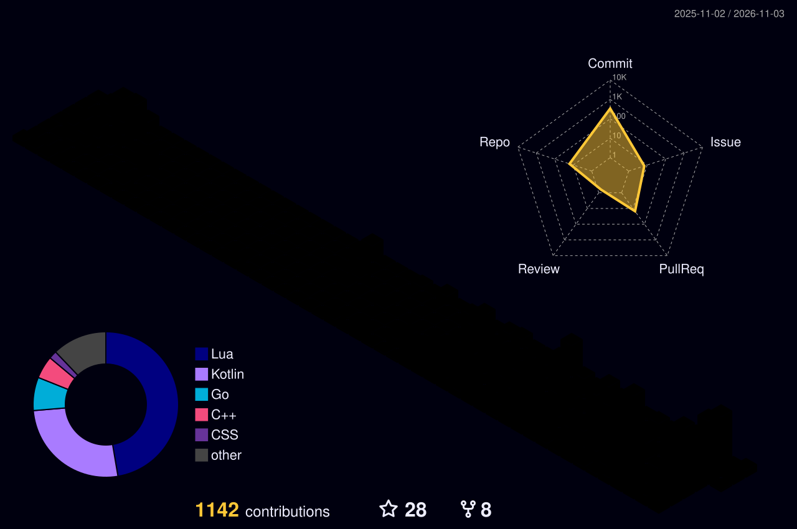

# 你好

我是 [0988](https://0988.nki.pw/)

## 正在进行的项目

- WenOS —— 一个使用 Rust、C++ 和汇编开发的操作系统。
- [WBuild](https://github.com/wjm13206/WBuild) —— 构建工具。
- [WenBlog](https://github.com/wjm13206/WenBlog) —— 一个用 php 开发的个人博客平台。
- (https://github.com/wjm13206/THubX) —— 一个功能强大的 Roblox 多功能工具集

## 在 GitHub 的精神状态

<picture>
  <source
    srcset="./profile-3d-contrib/profile-night-rainbow.svg"
    media="(prefers-color-scheme: dark)"
  />
  <source
    srcset="./profile-3d-contrib/profile-green-animate.svg"
    media="(prefers-color-scheme: light), (prefers-color-scheme: no-preference)"
  />
  
</picture>

<picture>
  <source
    srcset="https://github-stats-extended.vercel.app/api?username=wjm13206&amp;include_all_commits=true&amp;theme=light_github&amp;locale=cn"
    media="(prefers-color-scheme: light), (prefers-color-scheme: no-preference)"
  />
  <source
    srcset="https://github-stats-extended.vercel.app/api?username=wjm13206&amp;include_all_commits=true&amp;theme=dark&amp;locale=cn"
    media="(prefers-color-scheme: dark)"
  />
  
</picture>

<picture>
  <source
    srcset="https://github-stats-extended.vercel.app/api/top-langs/?username=wjm13206&amp;locale=cn&amp;layout=compact&amp;theme=dark"
    media="(prefers-color-scheme: dark)"
  />
  <source
    srcset="https://github-stats-extended.vercel.app/api/top-langs/?username=wjm13206&amp;locale=cn&amp;layout=compact&amp;theme=default"
    media="(prefers-color-scheme: light), (prefers-color-scheme: no-preference)"
  />
  
</picture>

##  工具:

&emsp;&emsp;

## 链接

- 博客 Blog | [https://0988.nki.pw/](https://0988.nki.pw/)
- 哔哩哔哩 Bilibili | [https://space.bilibili.com/3546791251282775](https://space.bilibili.com/3546791251282775)

